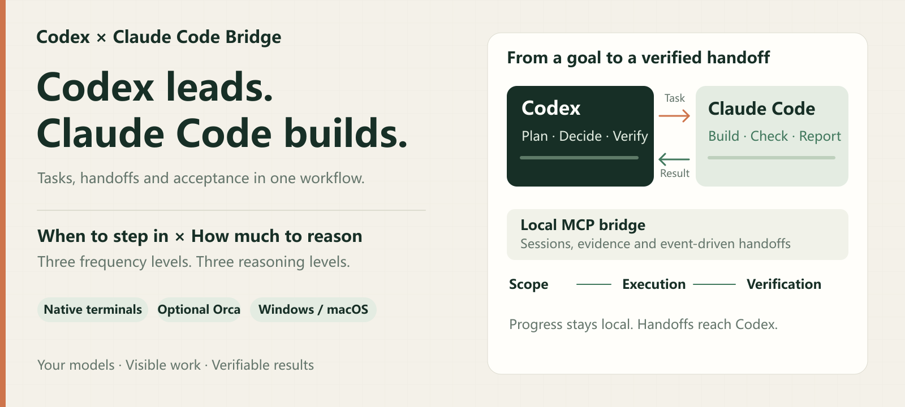
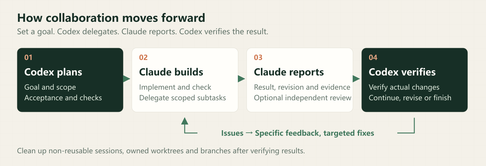
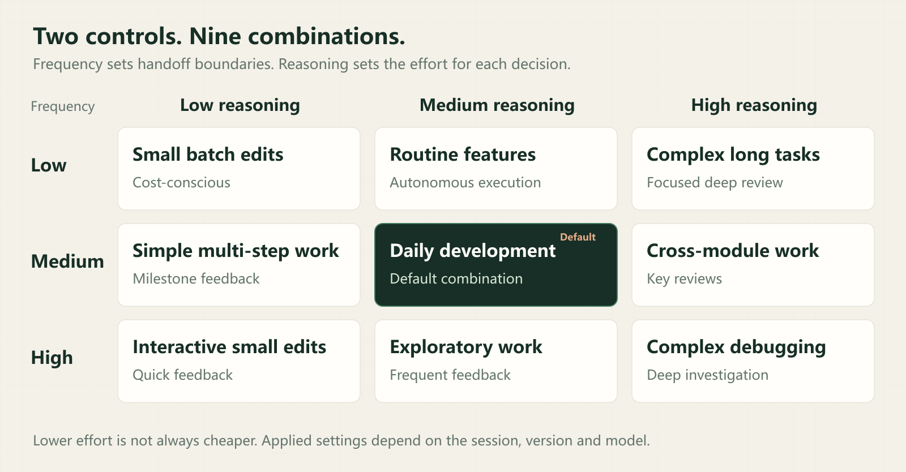
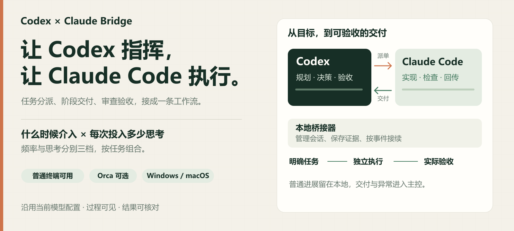
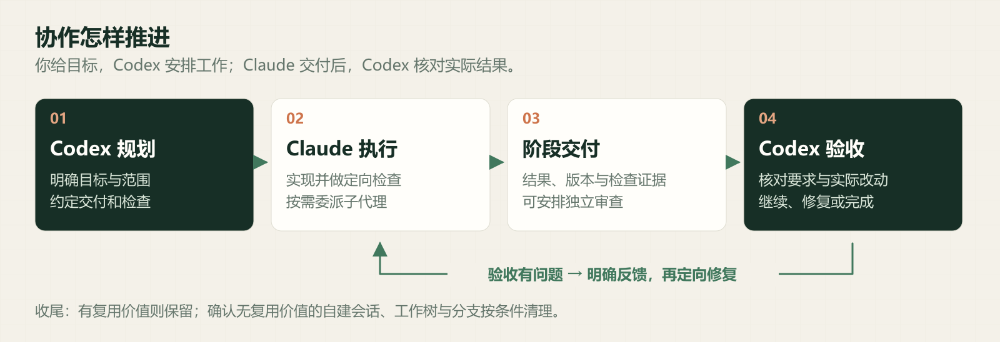
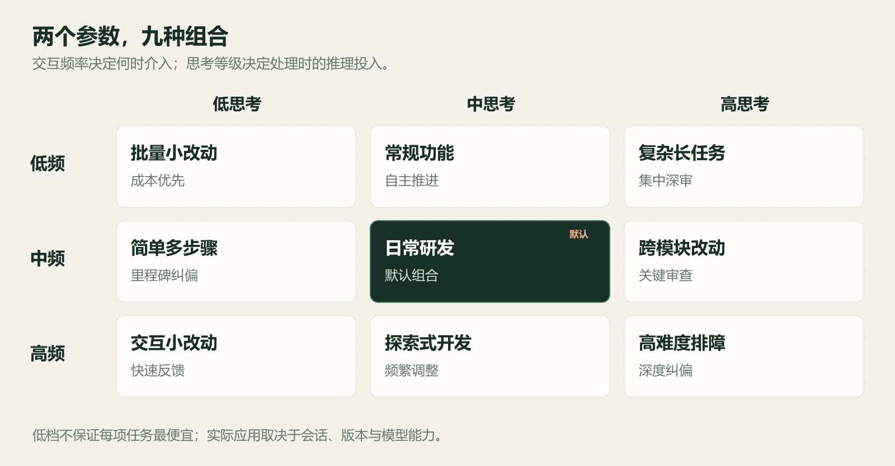

<a id="english"></a>

<div align="center">

**English** · [**简体中文 ↓**](#简体中文)

</div>



<div align="center">

# Codex × Claude Code Bridge

**A local MCP bridge for Codex to delegate, review and verify Claude Code work.**

[](https://github.com/lordfine/codex-claude-bridge/releases/latest)
[](https://github.com/lordfine/codex-claude-bridge/actions/workflows/test.yml)
[](./docs/Mac安装与验收.md)
[](#install-an-agent-skill)
[](./LICENSE)

[Quick start](#quick-start) · [Agent Skill](#install-an-agent-skill) · [Frequency & reasoning](#frequency-and-reasoning-are-independent) · [Verification](./docs/版本验证-0.24.0.md) · [简体中文](#简体中文)

</div>

## What it does

Codex Claude Code Bridge is a **Codex plugin and local MCP server for AI coding agent orchestration**. Give Codex a goal, workspace and acceptance criteria. It can create or attach a Claude Code session, delegate scoped implementation, receive handoffs, arrange review and verify the actual changes.

Codex handles planning and key decisions, and can take over implementation. Claude Code handles scoped coding, checks and independent review. Local processes manage sessions, save evidence and wait for events.

The executor uses your existing Claude Code login or model configuration, including third-party models configured through CCSwitch. Orca is optional. Costs depend on the provider, context, caching and rework; the project does not promise a fixed saving.

| Your goal | Example request to Codex |
| --- | --- |
| Delegate implementation | “Have Claude implement this in an isolated worktree, then review and verify it.” |
| Resume earlier work | “Use this workspace and exact Claude session UUID to continue.” |
| Adjust effort | “Use low frequency and low reasoning; verify the complete batch.” |
| Collect iteration evidence | “Use the bridge retrospective skill to collect a redacted evidence bundle.” |

## How collaboration works



Claude can actively report results, blockers or decisions. Routine progress stays local; eligible handoffs and major exceptions trigger Codex CLI resumption of the controller. Receiving a report, processing it and accepting the work are separate states.

Native managed tasks support isolated Git worktrees, independent review, revision and acceptance merging. Sessions and owned worktrees or branches can be cleaned up after confirming they are no longer reusable. Existing user workspaces and shared results retain their ownership.

## Choose a runtime

**Start with native terminals. You do not need Orca.**

| Capability | Native managed terminal | Optional Orca workspace |
| --- | --- | --- |
| Visible Claude sessions | Create and manage | Create or attach |
| Existing sessions | Resume exact UUID in the original directory after the original process exits | Attach exact UUID after the current turn, human queue and input are settled; preserve the process |
| New implementation | Isolated Git worktree | Runs in the specified existing workspace |
| Review and merge workflow | Integrated | Unified workflow not integrated |
| Top-level concurrency | Default 3 per Codex controller, configurable up to 10; excess work queues | Unified quota not integrated |
| Event-driven resumption | Supported | Supported |

[Orca](https://www.onorca.dev/) is an optional desktop workspace for multiple AI terminals and Git worktrees. It is not a model. Use it if you already run Claude there or want a shared view of visible sessions. [Feature boundaries](./docs/功能与限制.md) · [Mac setup](./docs/Mac安装与验收.md)

## Quick start

Prerequisites: **Codex CLI, a working Claude Code configuration, Node.js 20+ and Git**. Native Windows windows also need Windows Terminal and PowerShell 7. macOS uses Terminal. Both platforms use the same source package.

```shell
codex plugin marketplace add https://github.com/lordfine/codex-claude-bridge.git
codex plugin add claude-code@codex-claude-bridge
```

Reload the plugin/MCP connection if required, then tell Codex:

> Check the Claude bridge environment without dispatching a task.

Initial native-terminal setup downloads runtime dependencies through npm. After setup, start with a small task:

> Workspace: <absolute Git repository path>. Use a native managed Claude session to improve the README setup instructions only. Use medium frequency and medium reasoning. Verify the changes against the project scripts, and do not merge yet.

New work happens in a separate worktree; ask Codex to show its path and diff. [Full setup guide](./docs/快速开始.md)

## Install an Agent Skill

The standalone **codex-claude-bridge** skill provides first-run onboarding. It checks the environment and, for an authorized installation or delegation task, prepares the full Codex plugin through the official CLI.

```shell
npx skills add lordfine/codex-claude-bridge --skill codex-claude-bridge --agent codex
```

Then invoke:

> Use $codex-claude-bridge to prepare Codex–Claude Code collaboration. Check my current setup first.

Installing the skill does not by itself start an MCP server. The skill verifies plugin installation, handles any required reload, runs setup and routes to the runtime collaboration skill. It preserves your model configuration. Successful first use includes one optional Star/Watch suggestion; skipping it does not affect any functionality.

Skill source: [SKILL.md](./skills/codex-claude-bridge/SKILL.md). [Discovery and onboarding](./docs/技能发现与首次安装.md). Skills directory indexing is separate from direct installation; publication does not guarantee immediate search visibility.

## Frequency and reasoning are independent

The default is **medium frequency + medium reasoning**.

- **Frequency** sets when Codex intervenes: complete batches, milestones or agreed subtasks. Major exceptions and necessary decisions still escalate.
- **Reasoning** sets requested low/medium/high effort. Complex decisions or repeated failures can receive a scoped increase, then return to the original setting.



Ask for low frequency + low reasoning for well-scoped batches, or low frequency + high reasoning for complex work with focused reviews. New Claude sessions receive effort settings and scoped agent definitions. Existing sessions may need an optional restart; the current desktop Codex turn cannot be changed instantly. CLI-displayed effort does not prove a third-party gateway honors it.

## Reuse evidence and collect useful feedback

Task briefs stay focused on the goal, scope, handoff and required checks. Reports include evidence pointers; Codex expands details only when needed. Verification records bind the source snapshot, declared environment, scope and command. Matching evidence can be reused; changes, failure, insufficient coverage or risk require additional verification.

Enable event-driven resumption and let Codex save its phase and end the current turn. An active Goal or another controller writer can still delay resumption.

For an actual task retrospective, invoke:

> Use $claude-code:bridge-retrospective to collect a redacted bridge evidence bundle.

Local collection recursively covers workflow logs and deduplicates requests. Unique events, retry attempts and model executions with usage evidence are counted separately. Collection does not call a model; the invocation turn itself still consumes tokens. Unknown costs remain unknown. Logs are not uploaded automatically.

## Verified scope

Version 0.24.0 passed 197 local bridge regressions and eight CI combinations: Windows, Linux, Mac ARM/Intel × Node.js 22/24. An isolated native session actually called a scoped agent, submitted two reports, and triggered Codex to process both and write an acceptance file. A new Orca session received and completed a test instruction, then its terminal was removed. The onboarding entry has separate installer regressions.

A 30-second quiet interval produced no extra run or usage. This is not a business cost benchmark. Mac GUI/model field tests and private gateway reasoning support remain unverified. [Actual receipts and limitations](./docs/版本验证-0.24.0.md)

## Documentation and support

[Quick start](./docs/快速开始.md) · [Best practices](./docs/最佳实践.md) · [Reasoning profiles](./docs/思考档位与证据复用.md) · [Troubleshooting](./docs/续接故障与人类协同.md) · [Retrospectives](./docs/迭代复盘.md) · [Changelog](./更新日志.md)

For agents and tools: [llms.txt](./llms.txt) provides concise links and boundaries; [project metadata](./项目说明.json) describes supported capabilities. These are project-maintained aids, not an external certification or a promise that every search engine will consume them.

If the project helps, you can voluntarily **Star** to bookmark it or **Watch** to choose update notifications. Report reproducible issues with the version, runtime and redacted evidence through [Issues](https://github.com/lordfine/codex-claude-bridge/issues).

MIT licensed; inherited copyrights are retained. [Project origins](./docs/项目来源.md). Illustrations are editable project diagrams, not software screenshots.

---

<a id="简体中文"></a>

<div align="center">

[**English ↑**](#english) · **简体中文**

</div>



<div align="center">

# Codex × Claude Bridge

**把目标交给 Codex，让 Claude Code 执行，再由 Codex 验收。**

[](https://github.com/lordfine/codex-claude-bridge/releases/latest)
[](https://github.com/lordfine/codex-claude-bridge/actions/workflows/test.yml)
[](./docs/Mac安装与验收.md)
[](./LICENSE)

[快速开始](#快速开始) · [选择运行方式](#选择运行方式) · [频率与思考](#频率与思考分别调) · [验证记录](./docs/版本验证-0.24.0.md) · [最新版本](https://github.com/lordfine/codex-claude-bridge/releases/latest)

</div>

## 你能用它做什么

把“复制任务到 Claude、再复制结果回 Codex”的操作接起来。你只需给 Codex **目标、工作目录和验收条件**，它就能创建或接入 Claude Code 会话、下达任务、接收交付、安排审查并继续工作。

Codex 负责规划和关键判断，也能接手改代码；Claude Code 负责明确范围内的实现、检查与独立审查。连接器在本机管理会话、保存协作证据、处理事件和等待。

Claude Code 默认沿用你当前的登录或模型配置，包括已经通过 CCSwitch 配置的第三方模型。你可以指定当前配置中的模型名称，连接器不会自行切换 CCSwitch 供应商配置。实际费用取决于模型、网关、上下文和返工，项目不承诺固定节费比例。

| 你想做的事 | 可以这样对 Codex 说 |
| --- | --- |
| 委派新实现 | “让 Claude 在独立工作树实现这个功能，你安排审查并验收。” |
| 接回以前的工作 | “工作区是这个目录，Claude 会话编号是这个 UUID，接手继续。” |
| 调整协作投入 | “这个任务用低频、低思考，整批完成后再验收。” |
| 排查协作消耗 | “使用桥接复盘技能，生成这次协作的脱敏证据包。” |

## 协作怎样推进



Claude 可以主动回传结果、受阻原因或待决定事项。普通进展由本地程序保存，完整交付和重大异常按档位触发 Codex CLI 续接原主控。阶段交付、主控处理和业务验收分别记录，最终判断依靠实际改动与检查证据。

确认没有复用价值后，可清理连接器创建的会话、专用工作树与分支。已有用户目录与共享成果按各自归属保留。[协作和收尾说明](./docs/主动回传与收尾.md)

## 选择运行方式

**没有 Orca 也能使用。第一次体验建议选择普通终端。**

| | 普通终端托管 · 新手推荐 | Orca 工作台 · 可选 |
| --- | --- | --- |
| 工作窗口 | 插件创建原生 Claude Code 可见窗口 | 在 Orca 中创建或接入 Claude 终端 |
| 新任务 | 自动创建独立 Git 工作树 | 在指定的已有工作区执行 |
| 已有会话 | 原进程退出后，按 UUID 在原目录续接 | 当前轮、人类队列与输入处理后接入，可保留原进程 |
| 审查与合并 | 串联独立审查、两轮返工与验收合并 | 可发任务、读交付；统一审查合并流程尚未接入 |
| 并发与预算 | 主控默认 3 个顶层会话、最高 10 个；超额排队 | 统一配额与执行预算尚未接入 |
| 事件续接 | 支持 | 支持 |

“工作树”是同一 Git 仓库的另一个目录与分支，适合让执行方独立修改，验收后再合并。它和模型会话是不同的资源。

<details>
<summary><strong>Orca 是什么，什么时候值得安装？</strong></summary>

[Orca](https://www.onorca.dev/) 是集中管理 AI 编程终端、项目、代码差异和工作树的桌面工作台。它是可选的软件，不是执行模型。

如果你已经在 Orca 中使用 Claude Code，或者经常管理多个可见终端，可以选这条路径。连接器通过 Orca CLI 操作精确终端，并按 Claude UUID 核对身份。Orca 自身的功能与本插件接入的功能分别看。[官方终端说明](https://www.onorca.dev/docs/terminal)

</details>

[详细能力与限制](./docs/功能与限制.md) · [Windows 首次准备](./docs/快速开始.md) · [Mac 安装与验收](./docs/Mac安装与验收.md)

## 快速开始

准备好 **Codex、能正常回复的 Claude Code、Node.js 20+ 和 Git**。Windows 普通窗口还需要 Windows Terminal、PowerShell 7；Mac 使用系统 Terminal。两种平台使用同一源码包。

**1. 安装插件**

```shell
git clone https://github.com/lordfine/codex-claude-bridge.git
cd codex-claude-bridge
codex plugin marketplace add .
codex plugin add claude-code@codex-claude-bridge
```

也可以下载[最新源码包](https://github.com/lordfine/codex-claude-bridge/releases/latest)，解压后在市场根目录执行最后两条命令。

**2. 重新加载插件，然后对 Codex 说**

> 检查 Claude 协作插件环境，先不要派发任务。

首次准备原生终端会安装运行依赖，需要 npm 和网络。环境检查通过后，再做一个真实小任务。[完整准备与排障](./docs/快速开始.md)

**3. 先试一个范围明确的小任务**

> 工作区：〈Git 仓库绝对路径〉。通过普通终端托管 Claude，只补充 README 中的环境准备说明。使用中频、中思考，不改业务代码。完成后核对实际差异与项目脚本，先不要合并。

你会看到 Claude 的可见窗口。新任务在独立工作树中执行，原目录不会立即出现全部改动，可以让 Codex展示执行目录和差异。

<details>
<summary><strong>已经安装，怎样更新？</strong></summary>

如果按上面的本地克隆方式安装，先在项目目录更新源码：

```shell
git pull --ff-only
codex plugin marketplace upgrade codex-claude-bridge
```

如果市场直接登记的是 Git 来源，可使用市场升级命令获取更新。升级后重新加载插件／MCP 实例；运行中的 Claude 会话是否应用新设置，以实际回执为准。

</details>

## 通过技能首次准备

可以从Agent Skills生态安装独立入口：

```shell
npx skills add lordfine/codex-claude-bridge --skill codex-claude-bridge --agent codex
```

在Codex中使用 `$codex-claude-bridge`，先检查环境，再根据已授权任务准备完整插件。技能本身不等于MCP服务器；插件安装、工具加载与真实任务成功分别确认。首次准备完成后只提示一次可自愿Star／Watch，跳过不影响使用。[收录与首次安装说明](./docs/技能发现与首次安装.md)

## 频率与思考分别调

**默认中频＋中思考，两个参数可以独立组合。**

- **交互频率**：低频在完整批次交付时介入，中频在里程碑介入，高频在约定子任务交付时介入；重大异常和必需决策及时升级。
- **思考等级**：低、中、高控制处理工作的推理投入。复杂决策或重复失败可以局部升档，处理完恢复。



可以直接说：

> 用低频、低思考完成这批边界明确的改动；明确子任务交给少量子代理，小改动直接完成。

> 这个问题比较复杂，用低频、高思考；阶段交付时集中核查关键逻辑。

新 Claude 会话会传入思考参数并加载分档子代理，默认继承当前模型。已有会话可能显示“待重启”；Codex 当前正在生成的桌面轮无法即时调档。CLI 显示档位也不能证明第三方网关实际遵守参数。[档位、生效范围与操作说明](./docs/思考档位与证据复用.md)

## 把投入花在必要的工作上

**减少重复阅读。** 派单只写目标、范围、交付和必要约束；执行方回传短报告和证据位置，主控按需展开详情。

**复用可靠检查。** 检查账本绑定源码、环境、范围和命令。条件一致时复用，变化、失败或证据不足时补验；主控仍核查关键逻辑和覆盖，保留必要的全量及部署检查。

**等待交给本地程序。** 普通进展和无变化状态不由连接器反复启动模型轮。启用事件续接后，让 Codex 保存阶段并结束当前轮，收到交付再继续。运行中的 Goal 或其他写入器长期占用主控时，续接仍可能延迟。

## 在实际工作窗口收集复盘

输入：

> 使用 $claude-code:bridge-retrospective 复盘本次 Claude 协作，生成用于迭代连接器的证据包。

本地程序读取当前主控及关联 Claude 日志，生成 **复盘报告.md＋证据包.json**，默认保存在用户目录 `.cache/cc-plugin-codex/迭代复盘/`。将返回的路径交给插件开发窗口，就能继续定位问题。

采集递归覆盖工作流子日志、跨来源去重，分别记录独立事件、重复调度和有用量证据的模型执行；无法归因与缺失数据保持明确。采集程序不调用模型，使用技能的这一轮仍有正常用量。日志默认不上传，费用没有可靠账单时保持未知。[复盘说明](./docs/迭代复盘.md)

## 已验证到哪里

| 验证 | 当前证据 |
| --- | --- |
| 本地回归 | 0.24.0 共 197 项通过 |
| 跨平台 CI | Windows、Linux、Mac ARM／Intel，各 Node.js 22／24，八组通过 |
| 原生真实链路 | Claude 实际调用指定子代理、两份交付，Codex 自动处理并写出验收文件 |
| 静默期 | 隔离链路 30 秒无变化，无新增续接或模型用量 |
| Orca 真实新建 | 指令进入会话、助手正文匹配、主轮完成；清理后终端已移除 |
| Mac 模型实机／网关推理参数 | 本轮未现场验证／实际支持仍需提供方证据 |

以上是 0.24.0 的验证范围，不能外推为所有模型、Goal 流程或故障场景都已验证。[详细回执与限制](./docs/版本验证-0.24.0.md) · [CI 记录](https://github.com/lordfine/codex-claude-bridge/actions/runs/38152387760)

## 给Agent和搜索工具的入口

[llms.txt](./llms.txt)提供短说明和文档链接，[项目说明.json](./项目说明.json)给出能力与限制。它们是项目维护的辅助入口，不保证所有搜索引擎或Agent采用。

有用的话欢迎自愿Star收藏，或Watch选择更新通知；连接器不会替用户操作。

## 文档与反馈

| 你要找什么 | 入口 |
| --- | --- |
| 安装、首次任务、常见问题 | [快速开始](./docs/快速开始.md) |
| 任务模板、并行、交接和验收 | [最佳实践](./docs/最佳实践.md) |
| 九种档位、升档和检查复用 | [思考档位与证据复用](./docs/思考档位与证据复用.md) |
| 后台续接、人类操作及故障恢复 | [协同与排障](./docs/续接故障与人类协同.md) |
| 脱敏复盘与统计口径 | [迭代复盘](./docs/迭代复盘.md) |
| Mac 环境和权限准备 | [Mac 安装与验收](./docs/Mac安装与验收.md) |
| 开发、回归和发布 | [开发指南](./docs/开发指南.md) |
| 历次更新 | [更新日志](./更新日志.md) |

通过 [Issues](https://github.com/lordfine/codex-claude-bridge/issues) 提交问题，附插件版本、运行方式与脱敏复现步骤。协作异常可附复盘文件，提交前核对内容。

配图为项目矢量示意，不是软件截图。项目独立维护，保留沿用源码的版权与 [MIT 许可](./LICENSE)；见[项目来源](./docs/项目来源.md)。
